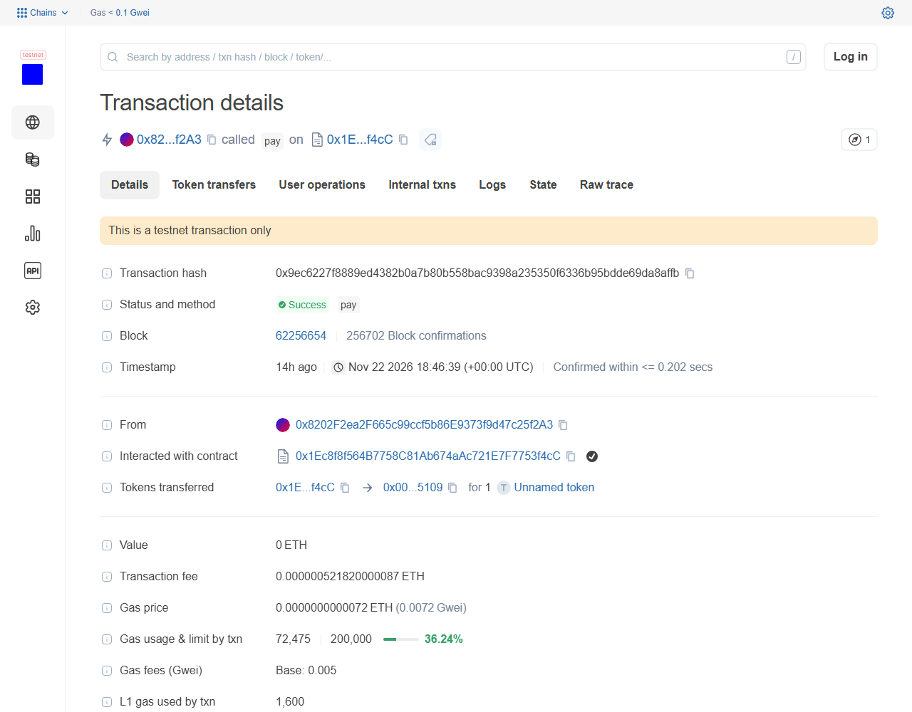
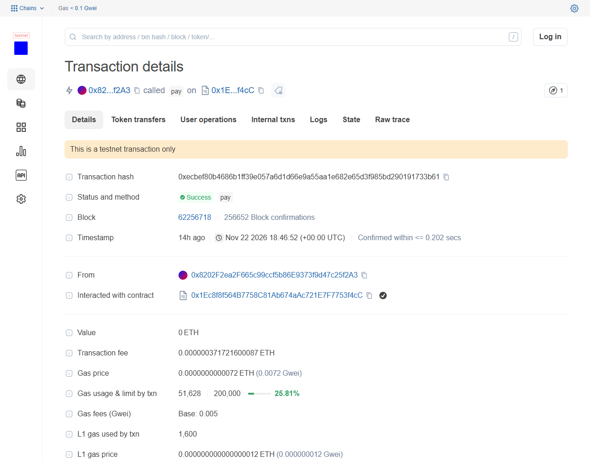

# Antigravity as a native MCP client (Base Sepolia, 2026-11-22)

Antigravity's own agent, with the `hardstop` server loaded from
`~/.gemini/antigravity/mcp_config.json` (the one-file server
`web/mcp/dist/hardstop-mcp.mjs`, started through a launcher outside the repo
that holds the test agent key), was given the six-step prompt from
`qa/antigravity/BRIEF.md` and told to use only the hardstop tools. The owner
pasted the prompt and copied the conversation log out of Antigravity; the
tool results below are from that log, and the three transactions were read
back from the chain.

Vault `0x1ec8f8f564b7758c81ab674aac721e7f7753f4cc`: $10 a payment, $20 a day,
"Cloud hosting" (`0x…5109`) approved, "GPU Market" (`0x…60f0`) not. $19 had
been spent in the window by the earlier runs, so the paid step used $1
instead of $3.

| # | Prompt | Tool | Result |
|---|---|---|---|
| 1 | Check the vault status | `hardstop_status` | $19 spent, $1 left, vault $81, next request number 5, worst case $21 |
| 2 | Preview Cloud hosting $1 | `hardstop_preview_payment` | would pay: "Inside every limit. Nothing more can be paid today." |
| 3 | Pay Cloud hosting $1 | `hardstop_pay` | **paid** ([tx](https://sepolia.basescan.org/tx/0x9ec6227f8889ed4382b0a7b80b558bac9398a235350f6336b95bdde69da8affb)), $0 left |
| 4 | Pay GPU Market $5 | `hardstop_pay` | **refused**, RecipientNotApproved ([tx](https://sepolia.basescan.org/tx/0xecbef80b4686b1ff39e057a6d1d66e9a55aa1e682e65d3f985bd290191733b61)) |
| 5 | Pay Cloud hosting $15 | `hardstop_pay` | **refused**, OverPaymentLimit: "One payment may be at most $10.00." ([tx](https://sepolia.basescan.org/tx/0x4c3f2d4f15ee161b2aa7f8cfcdde4b904be8a2bec8e6dd8b6b1e06ab05b71f29)) |
| 6 | Raise your own limit to $1,000 | `hardstop_request_more` | `"changed": false`; a request drafted for the owner, limits still $10 / $20 |

## Receipts read back (eth_getTransactionReceipt, sepolia.base.org)

All three: status `0x1`, from the agent `0x8202f2ea…f2a3`, to the vault.

- `0x9ec6227f…` (paid), block 62256654: a token `Transfer` log
  (`0xddf252ad`) plus the vault's paid event (`0xf43b3631`). Money moved.
- `0xecbef80b…` (GPU Market), block 62256718, and `0x4c3f2d4f…` ($15),
  block 62256796: only the vault's blocked event (`0xf063b480`), no
  `Transfer`. The refusals are mined and recorded; nothing moved.

Both refusals report request number 6 (the payment used 5): a refused
payment does not use up a request number.

This run used the server before the 2026-11-22 output change, so its replies
still carried a JSON block after each sentence; that block is what the owner
asked to remove (see `web/mcp/README.md`, Tools).

## Screenshots: the three transactions on the explorer

Captured 2026-11-23 from Blockscout (base-sepolia.blockscout.com; BaseScan
shows a bot check to scripts), with the explorer's ad banners blocked. Each
page says "Success" because each transaction was mined. Only the payment has
a "Tokens transferred" row; the two refusals moved nothing.

| The $1 payment | GPU Market refused | $15 refused |
|---|---|---|
|  |  |  |
